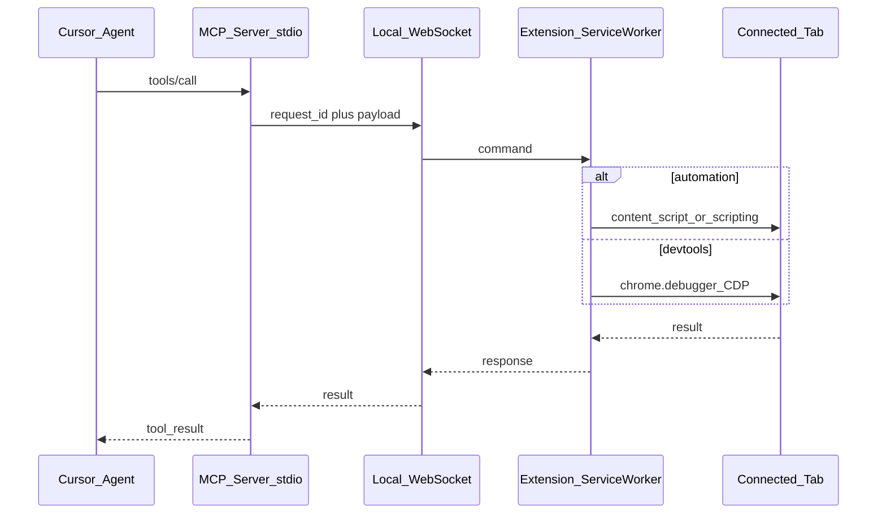

# SPEC: dev-tool-mcp

Chrome Manifest V3 extension + TypeScript MCP server that lets an AI agent automate and inspect the user's real Chrome browser (logged-in profile), with explicit per-tab Connect control and hybrid page automation + DevTools (CDP) access.

Status: v1 implemented (see README for setup)

---

## 1. Problem / goals / non-goals

### Problem

Agents in Cursor (and similar MCP hosts) can already drive browsers via Playwright MCP or Chrome DevTools MCP, but those typically launch or attach outside the user's everyday profile. Logged-in sessions, cookies, extensions, and real fingerprints are hard to reuse. Browser MCP solves the "real profile + Connect tab" model; this project matches that UX and adds deeper DevTools capabilities via `chrome.debugger`.

### Goals

- Drive the **user's existing Chrome profile** (sessions, cookies, fingerprint stay as-is).
- Expose an **MCP tool surface** to Cursor over stdio.
- Bridge MCP ↔ extension over a **localhost WebSocket**.
- **BrowserMCP-style popup**: user explicitly Connects / Disconnects which tab the agent may control.
- **Hybrid execution**:
  - Content scripts / `chrome.scripting` for accessibility-driven automation (navigate, snapshot, click, type, …).
  - `chrome.debugger` (CDP) for console, network, storage, evaluation, and an allowlisted raw CDP escape hatch.
- Local-only: no remote relay of browser traffic.
- Download / upload file-picker management beyond basic drag/drop if automation needs it later.

### Non-goals (v1)

- Multi-tab allowlists (only one Connected tab at a time).
- Recording / replay, Lighthouse, performance-trace UI.
- Native Messaging host (WebSocket only for v1).
- Chrome Web Store publication packaging.
- Replacing Playwright MCP for headless CI; this product is interactive-profile automation.

### Parity vs differentiation

| Aspect | Browser MCP | dev-tool-mcp |
|--------|-------------|--------------|
| Real Chrome profile | Yes | Yes |
| Popup Connect / Disconnect tab | Yes | Yes (same job: gate which tab the agent may touch) |
| Local MCP + extension bridge | Yes | Yes (stdio MCP + localhost WS) |
| A11y snapshot + click/type automation | Yes | Yes |
| Screenshot, console logs | Yes | Yes |
| Network bodies, storage, box model, raw CDP | Limited / not the focus | First-class via `chrome.debugger` |

References: [Browser MCP](https://github.com/BrowserMCP/mcp), [docs](https://docs.browsermcp.io/), [Connect troubleshooting](https://docs.browsermcp.io/troubleshooting).

---

## 2. Architecture and trust model

### High-level flow



### Components

| Path | Role |
|------|------|
| `server/` | Node/TypeScript MCP server (stdio), tool registry, WebSocket server on `127.0.0.1`, request/response correlation, connection state |
| `extension/` | MV3 package: service worker (WS client, router, debugger lifecycle), content script(s), popup |

### Trust model

1. **Localhost only**: WebSocket listens on `127.0.0.1` (never `0.0.0.0`).
2. **Connect gate**: Extension rejects all page-affecting commands unless a tab is Connected in the popup. MCP tools return a clear error if no Connected tab.
3. **Handshake token** (recommended): On first MCP server start (or extension install), generate a random token. Extension stores it in `chrome.storage.local`; every WS message from the server must include it (or the initial WS upgrade authenticates with it). Reject mismatched clients.
4. **No cloud**: Browser content stays on the machine; MCP host (Cursor) still receives tool results in its context by design of MCP.

### Connection state (server)

```ts
type BridgeState = {
  extensionConnected: boolean; // WS open from extension SW
  connectedTabId: number | null; // Chrome tab id user Connected
  connectedTabUrl: string | null;
  connectedTabTitle: string | null;
  debuggerAttached: boolean;
};
```

Extension is source of truth for `connectedTab*`; it pushes state updates to the server on Connect / Disconnect / tab close / URL change.

---

## 3. Extension modules and messaging protocol

### Modules

```
extension/
  manifest.json
  background/          # service worker entry
    sw.ts              # WS client, keepalive, command router
    debugger.ts        # attach/detach, CDP send, event buffers
    tabs.ts            # Connect state, restricted-URL checks
  content/
    automation.ts      # snapshot, click, type, hover, drag (isolated world)
  popup/
    popup.html
    popup.css
    popup.ts
  shared/
    protocol.ts        # message types shared conceptually with server
    errors.ts
```

```
server/
  src/
    index.ts           # stdio MCP entry + start WS
    mcp.ts             # tool registration
    ws-bridge.ts       # WebSocket server + correlation
    state.ts
    tools/
      navigation.ts
      interaction.ts
      snapshot.ts
      screenshot.ts
      console.ts
      network.ts
      storage.ts
      evaluate.ts
      debugger.ts
      cdp.ts
    protocol.ts
```

### WebSocket protocol

- **Transport**: `ws://127.0.0.1:<port>` (default port **17373**, overridable via env `DEV_TOOL_MCP_WS_PORT`).
- **Framing**: one JSON object per WebSocket message (text frames).
- **Direction**:
  - Server → extension: `request`
  - Extension → server: `response` | `event`

#### Request

```json
{
  "type": "request",
  "id": "uuid",
  "token": "<handshake>",
  "method": "tabs.snapshot",
  "params": {}
}
```

#### Response

```json
{
  "type": "response",
  "id": "uuid",
  "ok": true,
  "result": {}
}
```

```json
{
  "type": "response",
  "id": "uuid",
  "ok": false,
  "error": {
    "code": "NO_CONNECTED_TAB",
    "message": "No tab Connected in the extension popup."
  }
}
```

#### Event (extension → server, unsolicited)

```json
{
  "type": "event",
  "event": "state.changed",
  "payload": {
    "extensionConnected": true,
    "connectedTabId": 123,
    "connectedTabUrl": "https://example.com/",
    "connectedTabTitle": "Example",
    "debuggerAttached": false
  }
}
```

Other events (buffered for tools): `console.message`, `network.request`, `network.response`, `debugger.detached`.

#### Method catalog (extension RPC)

| Method | Side | Description |
|--------|------|-------------|
| `ping` | both | Liveness |
| `state.get` | → ext | Current Connect / debugger state |
| `tabs.connect` | → ext | Connect given `tabId` (popup uses this; MCP may not expose) |
| `tabs.disconnect` | → ext | Clear Connected tab; detach debugger |
| `tabs.navigate` | → ext | `chrome.tabs.update` URL |
| `tabs.goBack` / `tabs.goForward` | → ext | History |
| `tabs.wait` | → ext | Wait ms and/or load complete |
| `page.snapshot` | → ext | A11y tree via content script |
| `page.click` / `hover` / `drag` / `type` / `pressKey` | → ext | Interaction by ref or selector policy |
| `page.screenshot` | → ext | Capture visible tab (PNG base64) |
| `page.evaluate` | → ext | Run JS (world: `isolated` \| `main`) |
| `debugger.attach` / `debugger.detach` | → ext | `chrome.debugger` |
| `debugger.sendCommand` | → ext | CDP method + params (allowlist enforced server-side too) |
| `console.list` / `console.clear` | → ext | From CDP buffer |
| `network.list` / `network.getResponseBody` | → ext | From CDP buffer |
| `storage.getCookies` / `setCookie` / `clearCookies` | → ext | Cookies for Connected origin |
| `storage.getLocal` / `setLocal` / `getSession` / `setSession` | → ext | Web storage via script injection or CDP |

Timeouts: default **30s** per request; extension cancels work and returns `TIMEOUT`.

---

## 4. Popup behavior

Job of the popup: **choose which tab the agent may control**, and show bridge health. No dashboard clutter.

### Layout (textual wireframe)

```
┌─────────────────────────────────────┐
│  dev-tool-mcp                       │
│  MCP bridge: ● Connected / ○ …      │
├─────────────────────────────────────┤
│  This tab                           │
│  Title of active tab                │
│  https://example.com/path           │
│                                     │
│  [ Connect ]   or   [ Disconnect ]  │
├─────────────────────────────────────┤
│  Agent target                       │
│  Connected: Example · example.com   │
│  or: No tab connected               │
├─────────────────────────────────────┤
│  Last error (if any)                │
│  Advanced: port 17373               │
└─────────────────────────────────────┘
```

### Behavior rules

1. **Connect** targets the **currently active tab** in the window where the popup was opened (BrowserMCP-style).
2. Connecting a new tab **Disconnects** the previous one (single Connected tab in v1).
3. **Disconnect** clears Connected state and **detaches** the debugger if attached.
4. Status lines:
   - Bridge: WebSocket to MCP server up / down / reconnecting.
   - Agent target: Connected tab title + origin, or “No tab connected”.
5. **Restricted URLs** fail Connect with a visible error:
   - `chrome://`, `chrome-extension://`, `edge://`, `about:`
   - Chrome Web Store
   - Other URLs where content scripts or debugger cannot run (document as discovered)
6. Closing the Connected tab auto-Disconnects and emits `state.changed`.
7. Navigating the Connected tab to a restricted URL auto-Disconnects.
8. Optional: badge on the extension icon (`ON` / empty) when a tab is Connected.

---

## 5. Manifest permissions matrix

```json
{
  "manifest_version": 3,
  "name": "dev-tool-mcp",
  "version": "0.1.0",
  "description": "Let a local MCP agent automate and inspect a Connected Chrome tab.",
  "permissions": [
    "tabs",
    "windows",
    "scripting",
    "storage",
    "debugger",
    "webNavigation",
    "activeTab"
  ],
  "host_permissions": ["<all_urls>"],
  "background": { "service_worker": "background/sw.js", "type": "module" },
  "action": { "default_popup": "popup/popup.html", "default_title": "dev-tool-mcp" },
  "content_scripts": []
}
```

Prefer **programmatic injection** (`chrome.scripting.executeScript` / register content scripts on Connect) over always-on content scripts, so pages are only touched after Connect.

| Permission | Why |
|------------|-----|
| `tabs` / `windows` | List active tab, navigate, read title/URL for popup |
| `scripting` | Inject automation helpers into Connected tab |
| `activeTab` | Extra affordance when user opens popup on a tab |
| `storage` | Handshake token, last port, last error |
| `debugger` | CDP attach for DevTools-depth tools |
| `webNavigation` | Load lifecycle, restricted-URL detection |
| `<all_urls>` | Inject / debugger on arbitrary https origins after user Connects |

**Install UX note**: `debugger` triggers Chrome’s strong warning (“full access to DevTools…”). README/popup copy should state that access is limited to the user-Connected tab and a local MCP server.

---

## 6. MCP tool catalog (v1)

Naming: `browser_*` for automation parity with Browser/Playwright MCP; `devtools_*` for debugger-backed tools. All tools operate on the **Connected** tab unless noted.

### 6.1 Automation

#### `browser_tabs`

List context for the agent: Connected tab + optionally other tabs (read-only metadata). Does not Connect tabs (user must use popup).

**Params**: `{ includeOthers?: boolean }`  
**Returns**: `{ connected: TabInfo | null, others?: TabInfo[] }`

#### `browser_navigate`

**Params**: `{ url: string }`  
**Returns**: `{ url, title }` after load (or timeout policy documented in errors).

#### `browser_go_back` / `browser_go_forward`

**Params**: `{}`  
**Returns**: `{ url, title }`

#### `browser_wait`

**Params**: `{ time?: number, load?: "complete" | "domcontentloaded" }`  
**Returns**: `{ ok: true }`

#### `browser_press_key`

**Params**: `{ key: string }`  
**Returns**: `{ ok: true }`

#### `browser_snapshot`

Accessibility snapshot of the Connected page (YAML or structured tree with `ref` handles for interaction). Prefer a11y tree over screenshots for action targeting.

**Params**: `{ interestingOnly?: boolean }`  
**Returns**: `{ snapshot: string, refs?: Record<string, unknown> }`

#### `browser_click`

**Params**: `{ ref: string, button?: "left" | "right" | "middle", doubleClick?: boolean }`  
**Returns**: `{ ok: true }`

#### `browser_hover`

**Params**: `{ ref: string }`  
**Returns**: `{ ok: true }`

#### `browser_drag`

**Params**: `{ startRef: string, endRef: string }`  
**Returns**: `{ ok: true }`

#### `browser_type`

**Params**: `{ ref: string, text: string, submit?: boolean, slowly?: boolean }`  
**Returns**: `{ ok: true }`

#### `browser_screenshot`

**Params**: `{ fullPage?: boolean }` (fullPage best-effort; may require CDP)  
**Returns**: image content (MCP image) or `{ mimeType, base64 }`

#### `browser_console_messages`

**Params**: `{ clear?: boolean }`  
**Returns**: `{ messages: ConsoleMessage[] }`  
Prefer CDP buffer when debugger attached; otherwise empty + note, or content-script hook if implemented as fallback.

### 6.2 DevTools

#### `devtools_attach` / `devtools_detach`

Explicit attach control. Auto-attach is also allowed on first DevTools tool (see §7).

**Params**: `{}`  
**Returns**: `{ attached: boolean }`

#### `devtools_network_requests`

**Params**: `{ filter?: string, limit?: number }`  
**Returns**: `{ requests: NetworkEntry[] }` (url, method, status, type, id, …)

#### `devtools_network_body`

**Params**: `{ requestId: string }`  
**Returns**: `{ body: string, base64Encoded: boolean }`

#### `devtools_console_messages`

Alias/stricter form of console via CDP only.

**Params**: `{ clear?: boolean }`  
**Returns**: `{ messages: ConsoleMessage[] }`

#### `devtools_evaluate`

**Params**: `{ expression: string, world?: "isolated" | "main", awaitPromise?: boolean }`  
**Returns**: `{ result: unknown }` (JSON-serializable; truncate large values)

#### `devtools_get_box_model`

**Params**: `{ ref?: string, selector?: string }`  
**Returns**: box model / bounding rect (CDP DOM helpers)

#### `devtools_get_computed_style`

**Params**: `{ ref?: string, selector?: string, properties?: string[] }`  
**Returns**: `{ styles: Record<string, string> }`

#### `devtools_cookies`

**Params**: `{ action: "get" | "set" | "clear", cookie?: CookieInput }`  
**Returns**: cookie list or `{ ok: true }`

#### `devtools_storage`

**Params**: `{ store: "local" | "session", action: "get" | "set" | "clear", key?: string, value?: string }`  
**Returns**: values or `{ ok: true }`

#### `devtools_cdp`

Raw CDP escape hatch.

**Params**: `{ method: string, params?: object }`  
**Returns**: CDP result object

**v1 allowlist** (extend carefully):

- Allowed domains: `Runtime`, `Console`, `Network`, `DOM`, `CSS`, `Page`, `DOMStorage`, `Input` (only if needed), `Overlay` (highlight)
- Denied: `Browser.*`, `Target.createBrowserContext`, `Target.closeTarget` (except Connected tab if ever needed), arbitrary process/OS controls, extension debugging of other extensions

Server and extension both enforce the allowlist.

---

## 7. Debugger attach policy and limitations

### Policy

1. Automation tools **do not require** debugger attach.
2. First call to any `devtools_*` tool (except detach) **auto-attaches** if not attached.
3. Popup **Disconnect** always detaches.
4. If attach fails (e.g. DevTools UI already open on that tab), return `DEBUGGER_ATTACH_FAILED` with guidance: close DevTools on that tab and retry.
5. While attached, buffer `Console` and `Network` events in the extension (ring buffer, e.g. last 1000 entries per channel).
6. Do not leave debugger attached after extension unload if possible; best-effort detach on SW shutdown.

### Known limitations

| Limitation | Implication |
|------------|-------------|
| `chrome.debugger` exclusivity | Open DevTools panel on the Connected tab often blocks attach |
| MV3 service worker sleep | Keepalive via WS ping; reconnect with backoff; in-flight requests may fail with `EXTENSION_DISCONNECTED` |
| Restricted pages | Cannot Connect / inject / debug |
| CSP / sandboxed frames | Some evaluate / injection paths fail; prefer a11y refs |
| `fullPage` screenshot | May need CDP Page.captureScreenshot stitching; mark best-effort in v1 |
| Install warning | `debugger` permission is scary; document honestly |

---

## 8. Error model

Stable `error.code` values returned through MCP tool errors:

| Code | When |
|------|------|
| `EXTENSION_DISCONNECTED` | No WebSocket from extension |
| `NO_CONNECTED_TAB` | Bridge up but user has not Connected a tab |
| `TAB_GONE` | Connected tab closed |
| `RESTRICTED_URL` | Connect or navigate landed on a blocked URL |
| `DEBUGGER_ATTACH_FAILED` | CDP attach failed / conflict |
| `DEBUGGER_NOT_ATTACHED` | Tool requires debugger and attach was refused |
| `CDP_METHOD_DENIED` | `devtools_cdp` method not allowlisted |
| `CONTENT_SCRIPT_FAILED` | Injection or automation helper failed |
| `TIMEOUT` | Request exceeded timeout |
| `INVALID_REF` | Snapshot ref missing / stale |
| `UNAUTHORIZED` | Handshake token mismatch |

Messages should be short and actionable (e.g. “Open the dev-tool-mcp popup and click Connect on the target tab.”).

---

## 9. Cursor MCP config example

After `server` is packaged (implementation phase):

```json
{
  "mcpServers": {
    "dev-tool-mcp": {
      "command": "npx",
      "args": ["tsx", "/absolute/path/to/dev-tool-mcp/server/src/index.ts"],
      "env": {
        "DEV_TOOL_MCP_WS_PORT": "17373"
      }
    }
  }
}
```

User flow:

1. Start / enable the MCP server in Cursor (spawns Node process + WS listener).
2. Load the unpacked extension from `extension/`.
3. Open the target site in Chrome; click the extension → **Connect**.
4. Ask the agent to automate or inspect that tab.

---

## 10. Implementation phases

1. **Scaffold** — `extension/` MV3 shell + `server/` TypeScript MCP stub; shared protocol types; default port + handshake token.
2. **Bridge + popup** — WS connect/reconnect, `state.*`, Connect / Disconnect, restricted URLs, Cursor config docs.
3. **Automation tools** — snapshot + interaction + navigation + screenshot; content-script injection on Connect.
4. **DevTools tools** — attach policy, console/network buffers, evaluate, storage/cookies, allowlisted `devtools_cdp`.
5. **Polish** — error codes, keepalive, badge, README, manual test checklist against real logged-in sites.

---

## 11. Open risks

- **SW lifecycle**: idle service workers may drop WS; need ping + exponential reconnect; consider `chrome.alarms` or offscreen document only if keepalive proves insufficient.
- **Debugger vs DevTools UI**: agents and humans cannot both hold CDP on the same tab easily; document and surface errors.
- **Security of localhost WS**: token handshake mitigates other local processes calling the extension; still trust the local machine user.
- **Ref staleness**: snapshots must be refreshed after navigation/DOM changes; tools should recommend re-snapshot on `INVALID_REF`.
- **Parity trap**: do not aim for 100% Playwright MCP API compatibility; aim for agent-effective tools plus DevTools depth.

---

## 12. Acceptance criteria (spec complete → ready to build)

- [x] Goals / non-goals and BrowserMCP parity vs DevTools differentiation documented
- [x] Architecture, trust model, WS protocol defined
- [x] Popup Connect UX specified
- [x] Permissions justified
- [x] v1 MCP tool catalog with params/returns
- [x] Debugger policy and error codes defined
- [x] Phased implementation plan

Implementation begins only after this SPEC is accepted for build.
