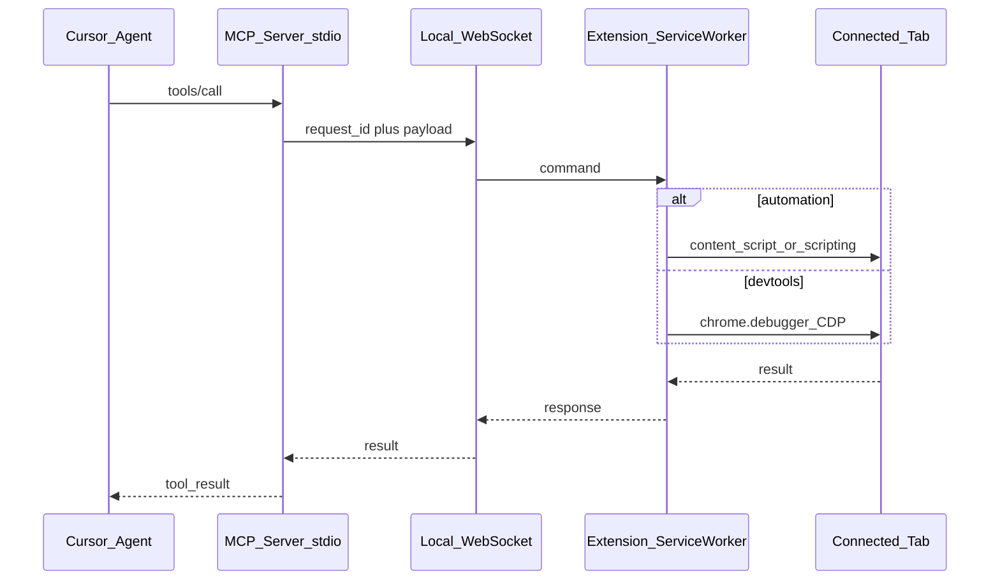

# SPEC: dev-tool-mcp

Chrome Manifest V3 extension + TypeScript MCP server that lets an AI agent automate and inspect the user's real Chrome browser (logged-in profile), with explicit per-tab Connect control and hybrid page automation + DevTools (CDP) access.

Status: v1 implemented (see README for setup)

---

## 1. Problem / goals / non-goals

### Problem

Agents in Cursor (and similar MCP hosts) can already drive browsers via Playwright MCP or Chrome DevTools MCP, but those typically launch or attach outside the user's everyday profile. Logged-in sessions, cookies, extensions, and real fingerprints are hard to reuse. Browser MCP solves the "real profile + Connect tab" model; this project matches that UX and adds deeper DevTools capabilities via `chrome.debugger`.

### Goals

- Drive the **user's existing Chrome profile** (sessions, cookies, fingerprint stay as-is).
- Expose an **MCP tool surface** to Cursor over stdio.
- Bridge MCP ↔ extension over a **localhost WebSocket**.
- **BrowserMCP-style popup**: user explicitly Connects / Disconnects which tab the agent may control.
- **Hybrid execution**:
  - Content scripts / `chrome.scripting` for accessibility-driven automation (navigate, snapshot, click, type, …).
  - `chrome.debugger` (CDP) for console, network, storage, evaluation, and an allowlisted raw CDP escape hatch.
- Local-only: no remote relay of browser traffic.
- Download / upload file-picker management beyond basic drag/drop if automation needs it later.

### Non-goals (v1)

- Multi-tab allowlists (only one Connected tab at a time).
- Recording / replay, Lighthouse, performance-trace UI.
- Native Messaging host (WebSocket only for v1).
- Chrome Web Store publication packaging.
- Replacing Playwright MCP for headless CI; this product is interactive-profile automation.

### Parity vs differentiation

| Aspect | Browser MCP | dev-tool-mcp |
|--------|-------------|--------------|
| Real Chrome profile | Yes | Yes |
| Popup Connect / Disconnect tab | Yes | Yes (same job: gate which tab the agent may touch) |
| Local MCP + extension bridge | Yes | Yes (stdio MCP + localhost WS) |
| A11y snapshot + click/type automation | Yes | Yes |
| Screenshot, console logs | Yes | Yes |
| Network bodies, storage, box model, raw CDP | Limited / not the focus | First-class via `chrome.debugger` |

References: [Browser MCP](https://github.com/BrowserMCP/mcp), [docs](https://docs.browsermcp.io/), [Connect troubleshooting](https://docs.browsermcp.io/troubleshooting).

---

## 2. Architecture and trust model

### High-level flow



### Components

| Path | Role |
|------|------|
| `server/` | Node/TypeScript MCP server (stdio), tool registry, WebSocket server on `127.0.0.1`, request/response correlation, connection state |
| `extension/` | MV3 package: service worker (WS client, router, debugger lifecycle), content script(s), popup |

### Trust model

1. **Localhost only**: WebSocket listens on `127.0.0.1` (never `0.0.0.0`).
2. **Connect gate**: Page-affecting commands require a Connected tab. The user can Connect from the popup, or the agent can `browser_open` / `browser_navigate` a non-restricted URL (creates a tab and Connects it). Restricted URLs (`chrome://`, Web Store, …) are always rejected.
3. **Per-port handshake token**: Each MCP instance has its own token (file, env, or generated). The extension fetches `GET /handshake` **per port** and stores `tokensByPort`. A mismatch closes only that socket.
4. **Per-session tabs**: The extension keeps a WebSocket to every discovered instance (ports 17373–17392, max 20). Each session owns at most one Connected tab and all tab-scoped RPCs act only on it. `browser_connect_tab` on a tab owned by another session asks the user to Allow/Deny. Optional display name via `DEV_TOOL_MCP_NAME`.
   - **Auto-allow**: an instance started with `DEV_TOOL_MCP_AUTO_ALLOW=1` advertises `autoAllow: true` in its `/health` identity. For that instance the extension grants control-lease and `browser_connect_tab` requests without a prompt, so headless/unattended sessions work when no human can click Allow/Deny. Opt-in, per-instance, default off; the flag is self-declared (a convenience for the user's own trusted localhost sessions, not a trust boundary — the `127.0.0.1` bind and per-port handshake token are). All other instances keep the prompt.
5. **No cloud**: Browser content stays on the machine; MCP host (Cursor) still receives tool results in its context by design of MCP.
6. **Secure input**: `browser_type_secure` opens a dedicated extension window (`chrome-extension://…/secure/secure.html`) — not an in-page overlay, so the page's scripts cannot read what is being typed. The value goes from that window straight to the service worker and content script, which type it into the Connected tab. It is never a tool argument, tool result, log line, or snapshot value. The tool returns only `{ filled, chars, submitted }`, and fields filled this way are redacted in later snapshots/find results. This protects the secret from the agent, not from the destination page, which receives it normally.

### Connection state (server)

```ts
type BridgeState = {
  extensionConnected: boolean; // WS open from extension SW
  connectedTabId: number | null; // Chrome tab id user Connected
  connectedTabUrl: string | null;
  connectedTabTitle: string | null;
  debuggerAttached: boolean;
};
```

Extension is source of truth for `connectedTab*`; it pushes state updates to the server on Connect / Disconnect / tab close / URL change.

---

## 3. Extension modules and messaging protocol

### Modules

```
extension/
  manifest.json
  background/          # service worker entry
    sw.ts              # command router, keepalive
    hub.ts             # multi-WS fan-out, per-port tokens, control lease + notifications
    debugger.ts        # attach/detach, CDP send, event buffers
    tabs.ts            # Connect state, restricted-URL checks
    pins.ts            # pin store + blocking pick waiter
    secure-input.ts    # extension-window secret prompt + delivery
  content/
    automation.ts      # snapshot, click, type, hover, drag (isolated world)
    picker.ts          # in-page pick overlay + selector helper
  secure/
    secure.html        # secure input window (own document, no page script access)
    secure.css
    secure.ts
  popup/
    popup.html
    popup.css
    popup.ts
  shared/
    protocol.ts        # message types shared conceptually with server
    errors.ts
```

```
server/
  src/
    index.ts           # stdio MCP entry + start WS
    mcp.ts             # tool registration
    ws-bridge.ts       # WebSocket server + correlation
    state.ts
    tools/
      navigation.ts
      interaction.ts
      snapshot.ts
      screenshot.ts
      console.ts
      network.ts
      storage.ts
      evaluate.ts
      debugger.ts
      cdp.ts
    protocol.ts
```

### WebSocket protocol

- **Transport**: `ws://127.0.0.1:<port>` (default port **17373**, overridable via env `DEV_TOOL_MCP_WS_PORT`). The extension connects to **every** instance in the discovery band (17373–17392).
- **Browser startup**: when a tool needs the extension and none is connected, the server waits briefly for a reconnect. If no Chrome process is running it launches Chrome with the user's normal profile (so the installed extension keeps its permissions), then waits up to `DEV_TOOL_MCP_CHROME_CONNECT_TIMEOUT_MS` (default 25 s). Disable with `DEV_TOOL_MCP_LAUNCH_CHROME=0`; configure with `DEV_TOOL_MCP_CHROME_BIN`, `DEV_TOOL_MCP_CHROME_PROFILE`, `DEV_TOOL_MCP_CHROME_USER_DATA_DIR`, `DEV_TOOL_MCP_CHROME_ARGS`, and `DEV_TOOL_MCP_CHROME_EXTENSION`.
- **Framing**: one JSON object per WebSocket message (text frames).
- **Direction**:
  - Server → extension: `request`
  - Extension → server: `response` | `event`
- **Identity**: `BridgeIdentity.name` from `DEV_TOOL_MCP_NAME` (optional). Display label is `name :port` (name falls back to the cwd project folder).

#### Request

```json
{
  "type": "request",
  "id": "uuid",
  "token": "<handshake>",
  "method": "tabs.snapshot",
  "params": {}
}
```

#### Response

```json
{
  "type": "response",
  "id": "uuid",
  "ok": true,
  "result": {}
}
```

```json
{
  "type": "response",
  "id": "uuid",
  "ok": false,
  "error": {
    "code": "NO_CONNECTED_TAB",
    "message": "No tab Connected in the extension popup."
  }
}
```

#### Event (extension → server, unsolicited)

```json
{
  "type": "event",
  "event": "state.changed",
  "payload": {
    "extensionConnected": true,
    "connectedTabId": 123,
    "connectedTabUrl": "https://example.com/",
    "connectedTabTitle": "Example",
    "debuggerAttached": false
  }
}
```

Other events (buffered for tools): `console.message`, `network.request`, `network.response`, `debugger.detached`, `control.changed`.

#### Method catalog (extension RPC)

| Method | Side | Description |
|--------|------|-------------|
| `ping` | both | Liveness |
| `state.get` | → ext | Current Connect / debugger state |
| `control.request` / `release` / `status` | → ext | Control lease (notify on steal) |
| `tabs.connect` | → ext | Connect given `tabId` (popup uses this; MCP may not expose) |
| `tabs.disconnect` | → ext | Clear Connected tab; detach debugger |
| `tabs.open` | → ext | Create a tab at `url`, wait for load, Connect it |
| `tabs.navigate` | → ext | `chrome.tabs.update` URL, or `tabs.open` if none Connected |
| `tabs.goBack` / `tabs.goForward` | → ext | History |
| `tabs.wait` | → ext | Wait ms and/or load complete |
| `page.snapshot` | → ext | A11y tree via content script |
| `page.click` / `hover` / `drag` / `type` / `pressKey` | → ext | Interaction by ref or selector policy |
| `page.screenshot` | → ext | Capture visible tab (PNG base64) |
| `page.evaluate` | → ext | Run JS (world: `isolated` \| `main`; optional `pin` binds `el`; CSP auto-fallback) |
| `debugger.attach` / `debugger.detach` | → ext | `chrome.debugger` |
| `debugger.sendCommand` | → ext | CDP method + params (allowlist enforced server-side too) |
| `console.list` / `console.clear` | → ext | From CDP buffer |
| `network.list` / `network.get` / `network.getResponseBody` / `network.forPin` | → ext | From CDP buffer (filters, WS, wait, pin correlation) |
| `pins.inspect` | → ext | Rich pin element inspection |
| `storage.getCookies` / `setCookie` / `clearCookies` | → ext | Cookies for Connected origin |
| `storage.getLocal` / `setLocal` / `getSession` / `setSession` | → ext | Web storage via script injection or CDP |

Timeouts: default **30s** per request; extension cancels work and returns `TIMEOUT`.

---

## 4. Popup behavior

Job of the popup: **choose which tab the agent may control**, and show bridge health. No dashboard clutter.

### Layout (textual wireframe)

```
┌─────────────────────────────────────┐
│  dev-tool-mcp                       │
│  MCP bridge: ● Connected / ○ …      │
├─────────────────────────────────────┤
│  This tab                           │
│  Title of active tab                │
│  https://example.com/path           │
│                                     │
│  [ Connect ]   or   [ Disconnect ]  │
├─────────────────────────────────────┤
│  Agent target                       │
│  Connected: Example · example.com   │
│  or: No tab connected               │
├─────────────────────────────────────┤
│  Last error (if any)                │
│  Advanced: port 17373               │
└─────────────────────────────────────┘
```

### Behavior rules

1. **Connect** targets the **currently active tab** in the window where the popup was opened (BrowserMCP-style).
2. Connecting a new tab **Disconnects** the previous one (single Connected tab in v1).
3. **Disconnect** clears Connected state and **detaches** the debugger if attached.
4. Status lines:
   - Bridge: WebSocket to MCP server up / down / reconnecting.
   - Agent target: Connected tab title + origin, or “No tab connected”.
5. **Restricted URLs** fail Connect with a visible error:
   - `chrome://`, `chrome-extension://`, `edge://`, `about:`
   - Chrome Web Store
   - Other URLs where content scripts or debugger cannot run (document as discovered)
6. Closing the Connected tab auto-Disconnects and emits `state.changed`.
7. Navigating the Connected tab to a restricted URL auto-Disconnects.
8. Optional: badge on the extension icon (`ON` / empty) when a tab is Connected.
9. **Bridges list**: every discovered MCP instance with `name :port`, connected vs controlling. **Control** grants the lease instantly (no notification). A pending steal shows as “pending from {name}”.

---

## 5. Manifest permissions matrix

```json
{
  "manifest_version": 3,
  "name": "dev-tool-mcp",
  "version": "0.1.0",
  "description": "Let a local MCP agent automate and inspect a Connected Chrome tab.",
  "permissions": [
    "tabs",
    "windows",
    "scripting",
    "storage",
    "debugger",
    "webNavigation",
    "activeTab",
    "cookies",
    "alarms",
    "notifications"
  ],
  "host_permissions": ["<all_urls>"],
  "background": { "service_worker": "background/sw.js", "type": "module" },
  "action": { "default_popup": "popup/popup.html", "default_title": "dev-tool-mcp" },
  "content_scripts": []
}
```

Prefer **programmatic injection** (`chrome.scripting.executeScript` / register content scripts on Connect) over always-on content scripts, so pages are only touched after Connect.

| Permission | Why |
|------------|-----|
| `tabs` / `windows` | List active tab, navigate, read title/URL for popup |
| `scripting` | Inject automation helpers into Connected tab |
| `activeTab` | Extra affordance when user opens popup on a tab |
| `storage` | Handshake tokens by port, controller port, last error |
| `debugger` | CDP attach for DevTools-depth tools |
| `webNavigation` | Load lifecycle, restricted-URL detection |
| `notifications` | Allow/Deny prompt when an instance asks to steal the control lease |
| `<all_urls>` | Inject / debugger on arbitrary https origins after user Connects |

**Install UX note**: `debugger` triggers Chrome’s strong warning (“full access to DevTools…”). README/popup copy should state that access is limited to the user-Connected tab and a local MCP server.

---

## 6. MCP tool catalog (v1)

Naming: `browser_*` for automation parity with Browser/Playwright MCP; `devtools_*` for debugger-backed tools. All tools operate on the **Connected** tab unless noted.

### 6.0 Control lease

#### `browser_request_control`

Ask to become the instance that may mutate the Connected tab. Auto-grants if nobody holds the lease; otherwise shows a Chrome Allow/Deny notification (60s).

**Params**: `{}`  
**Returns**: `{ controllerPort, controlling, identity }`

#### `browser_release_control`

Yield the lease so the next instance can auto-grant without a notification.

#### `browser_control_status`

Who currently holds the lease.

Mutating tools (`browser_click`, navigate, evaluate, …) auto-request control when needed. Read-only tools (`browser_snapshot`, network list, …) do not.

### 6.1 Automation

#### `browser_tabs`

List context for the agent: Connected tab + optionally other tabs (read-only metadata).

**Params**: `{ includeOthers?: boolean }`  
**Returns**: `{ connected: TabInfo | null, others?: TabInfo[] }`

#### `browser_open`

Open `url` in a **new** Chrome tab, wait for load, and Connect it. Does not require an existing Connected tab. Previous Connected tab is disconnected (pins/debugger cleared). Restricted URLs are rejected.

**Params**: `{ url: string, active?: boolean }`  
**Returns**: `{ url, title, tabId, opened: true, connectedTabId }`

#### `browser_navigate`

Navigate the Connected tab to a URL. If none is Connected, same as `browser_open`.

**Params**: `{ url: string }`  
**Returns**: `{ url, title, tabId, opened: boolean }` after load.

#### `browser_go_back` / `browser_go_forward`

**Params**: `{}`  
**Returns**: `{ url, title }`

#### `browser_wait`

**Params**: `{ time?: number, load?: "complete" | "domcontentloaded" }`  
**Returns**: `{ ok: true }`

#### `browser_press_key`

**Params**: `{ key: string }`  
**Returns**: `{ ok: true }`

#### `browser_snapshot`

Accessibility snapshot of the Connected page (YAML or structured tree with `ref` handles for interaction). Prefer a11y tree over screenshots for action targeting.

**Params**: `{ interestingOnly?: boolean }`  
**Returns**: `{ snapshot: string, refs?: Record<string, unknown> }`

#### `browser_click`

**Params**: `{ ref?: string, pin?: string, button?: "left" | "right" | "middle", doubleClick?: boolean }`  
Exactly one of `ref` or `pin` is required.  
**Returns**: `{ ok: true }`

#### `browser_hover`

**Params**: `{ ref?: string, pin?: string }` (exactly one)  
**Returns**: `{ ok: true }`

#### `browser_drag`

**Params**: `{ startRef?: string, endRef?: string, startPin?: string, endPin?: string }`  
Each endpoint requires exactly one of ref or pin.  
**Returns**: `{ ok: true }`

#### `browser_type`

**Params**: `{ ref?: string, pin?: string, text: string, submit?: boolean, slowly?: boolean }` (exactly one of ref/pin)  
**Returns**: `{ ok: true }`

Never pass a secret as `text`; use `browser_type_secure`.

#### `browser_type_secure`

Ask the user to type a secret (password, OTP, API key) into a dedicated extension window, then type it into the target. Blocks until submit, cancel, or timeout (default 120s, max 300s).

**Params**: `{ ref?: string, pin?: string, label?: string, kind?: "password" | "text" | "otp", targetHint?: string, submit?: boolean, waitForNavigation?: boolean, timeoutMs?: number }` (exactly one of ref/pin)  
**Returns**: `{ filled: true, chars: number, submitted: boolean, navigated?, url?, title? }` — never the value.  
Errors: `SECURE_INPUT_CANCELLED`, `SECURE_INPUT_TIMEOUT`, `SECURE_INPUT_BUSY`, `SECURE_INPUT_FAILED`.

RPC: `page.typeSecure`. The window is an extension page (not an in-page overlay); the value flows window → service worker → content script `typeSecret` action → element, and the element is marked so snapshots/find show `value=<redacted>`. A main-frame navigation, tab close, Disconnect, or session disconnect cancels a pending prompt.

#### `browser_pick_element`

Enter in-page pick mode on the Connected tab (overlay highlight). Blocks until the user clicks an element, presses Esc, or the timeout elapses (default 90s). Also available from the popup **Pick element** button (non-blocking; pin appears in `browser_pins`).

**Params**: `{ prompt?: string }`  
**Returns**: `PinDescriptor` (`id`, `tabId`, `url`, `tag`, `role`, `name`, `selector`, `box`, `createdAt`)

RPC: `page.pickElement`. Pins accumulate (`pin_1`, `pin_2`, …). Cleared on main-frame navigation, Disconnect, or `browser_pin_clear`. Top frame only in v1.

#### `browser_pick_cancel`

**Params**: `{}`  
**Returns**: `{ ok: true }`  
Cancels an in-progress pick (`PICK_CANCELLED` for the waiting `browser_pick_element` call).

#### `browser_pins`

**Params**: `{}`  
**Returns**: `{ pins: PinDescriptor[] }`

#### `browser_pin_inspect`

**Params**: `{ pin: string }`  
**Returns**: live inspection (`attrs`, `src`/`currentSrc`/`href`, `nearbyText`, `outerHTML`, `relatedUrls`, `matchCount`, …) plus stored `PinDescriptor`

#### `browser_pin_clear`

**Params**: `{ id?: string }` — omit to clear all  
**Returns**: `{ cleared: number }`

#### `browser_screenshot`

**Params**: `{ fullPage?: boolean }` (fullPage best-effort; may require CDP)  
**Returns**: image content (MCP image) or `{ mimeType, base64 }`

#### `browser_console_messages`

**Params**: `{ clear?: boolean }`  
**Returns**: `{ messages: ConsoleMessage[] }`  
Prefer CDP buffer when debugger attached; otherwise empty + note, or content-script hook if implemented as fallback.

### 6.2 DevTools

#### `devtools_attach` / `devtools_detach`

Explicit attach control. Auto-attach is also allowed on first DevTools tool (see §7).

**Params**: `{}`  
**Returns** (`attach`): `{ attached: boolean, workersAttached: [{ targetId, type, url }], workerAttachErrors?: [...] }`  
**Returns** (`detach`): `{ attached: false }`

On attach, related **existing** workers (`worker` / `shared_worker` / `service_worker` for the Connected tab or same origin) are attached via `chrome.debugger.getTargets` + `attach({ targetId })` with `Network.enable`. New workers continue to use CDP `Target.setAutoAttach` (flatten). Detach tears down the tab session and any worker sessions this extension explicitly attached.

#### `devtools_targets`

**Params**: `{}`  
**Returns**: `{ targets: [{ targetId, type, url, title?, tabId?, attached }], debuggerAttached }`

Lists the page target plus related workers from `chrome.debugger.getTargets` (same relatedness rules as attach).

#### `devtools_network_requests`

Auto-attaches CDP. Buffer fills only after attach (`bufferStartedAt` in the response). Existing related workers are attached on debugger attach; new workers via `Target.setAutoAttach`.

**Params**:
```
{
  filter?: string,          // legacy URL substring
  url?: string,             // URL substring
  urlRegex?: string,
  method?: string,
  host?: string,
  type?: string,            // CDP resource type
  status?: number,
  statusMin?: number,
  statusMax?: number,
  since?: number,           // ms epoch
  resourceKind?: "http" | "websocket",
  targetType?: string,      // page | worker | service_worker | …
  limit?: number,
  includeWebSocketMessages?: boolean,
  waitForMs?: number        // block until a new matching request; max 300000; bridge timeout = wait + 10s
}
```

**Returns**: `{ requests: NetworkEntry[], bufferStartedAt, debuggerAttached, timedOut?, note? }`

`NetworkEntry` includes headers, postData, initiator, fromCache, serviceWorkerResponseSource, targetType/targetId, and optional WebSocket frames.

#### `devtools_network_summary`

Compact aggregation over the network ring buffer (no extra CDP). Prefer this for host/path discovery before full `devtools_network_requests`.

**Params**: `{ since?: number, limitHosts?: number, limitPaths?: number }`  
**Returns**:
```
{
  bufferStartedAt, debuggerAttached, total,
  byHost: [{ host, count, lastTimestamp }],
  byTargetType: Record<string, number>,
  topPaths: [{ method, origin, pathPrefix, count, lastTimestamp }],
  webSockets: [{ url, id, messageCount?, finished? }]
}
```

#### `devtools_network_request`

**Params**: `{ requestId: string }`  
**Returns**: `{ request: NetworkEntry | null, bufferStartedAt }` (full detail + WS frames)

#### `devtools_network_body`

**Params**: `{ requestId: string }`  
**Returns**: `{ body: string, base64Encoded: boolean }`

#### `devtools_network_for_pin`

Inspects a pin’s related URLs (`src` / `href` / CSS backgrounds) and returns matching buffered requests.

**Params**: `{ pin: string, limit?: number, includeWebSocketMessages?: boolean }`  
**Returns**: `{ pin, relatedUrls, requests, bufferStartedAt, note? }`

#### `devtools_console_messages`

Alias/stricter form of console via CDP only.

**Params**: `{ clear?: boolean }`  
**Returns**: `{ messages: ConsoleMessage[] }`

#### `devtools_evaluate`

**Params**: `{ expression: string, world?: "isolated" | "main", awaitPromise?: boolean, pin?: string }`  
**Returns**: `{ result: unknown, world?: string, fallbackFrom?: string, note?: string }`

When `pin` is set, the expression is evaluated with `el` bound to the pinned element. Isolated-world failures caused by CSP `unsafe-eval` automatically retry via CDP `Runtime.evaluate` in the main world.

#### `devtools_get_box_model`

**Params**: `{ ref?: string, selector?: string }`  
**Returns**: box model / bounding rect (CDP DOM helpers)

#### `devtools_get_computed_style`

**Params**: `{ ref?: string, selector?: string, properties?: string[] }`  
**Returns**: `{ styles: Record<string, string> }`

#### `devtools_cookies`

**Params**: `{ action: "get" | "set" | "clear", cookie?: CookieInput }`  
**Returns**: cookie list or `{ ok: true }`

#### `devtools_storage`

**Params**: `{ store: "local" | "session", action: "get" | "set" | "clear", key?: string, value?: string }`  
**Returns**: values or `{ ok: true }`

#### `devtools_cdp`

Raw CDP escape hatch.

**Params**: `{ method: string, params?: object }`  
**Returns**: CDP result object

**v1 allowlist** (extend carefully):

- Allowed domains: `Runtime`, `Console`, `Network`, `DOM`, `CSS`, `Page`, `DOMStorage`, `Input`, `Overlay`, `Accessibility`, `Target` (read / attach helpers)
- Denied exact: `Browser.*`, `Target.createBrowserContext`, `Target.disposeBrowserContext`, `Target.createTarget`, `Target.closeTarget`, `Target.attachToBrowserTarget`, `Target.activateTarget`, `Browser.grantPermissions`, `SystemInfo.getInfo`

Server and extension both enforce the allowlist.

---

## 7. Debugger attach policy and limitations

### Policy

1. Automation tools **do not require** debugger attach.
2. First call to any `devtools_*` tool (except detach) **auto-attaches** if not attached.
3. Popup **Disconnect** always detaches.
4. If attach fails (e.g. DevTools UI already open on that tab), return `DEBUGGER_ATTACH_FAILED` with guidance: close DevTools on that tab and retry.
5. While attached, buffer `Console` and `Network` events in the extension (ring buffer, e.g. last 1000 entries per channel), including WebSocket handshake/frames when emitted.
6. On attach: enable `Target.setAutoAttach` (flatten) for **new** workers; also enumerate related **existing** workers via `chrome.debugger.getTargets` and `attach({ targetId })` with `Network.enable` (CDP `Target.getTargets` is often denied on tab debugger sessions).
7. `waitForMs` max is `MAX_NETWORK_WAIT_FOR_MS` (300000); the MCP bridge timeout is `waitForMs + 10000` so expiry returns `{ timedOut: true }` instead of a bridge TIMEOUT.
8. Do not leave debugger attached after extension unload if possible; best-effort detach on SW shutdown (tab + explicitly attached workers).

### Known limitations

| Limitation | Implication |
|------------|-------------|
| `chrome.debugger` exclusivity | Open DevTools panel on the Connected tab often blocks attach |
| MV3 service worker sleep | Keepalive via WS ping; reconnect with backoff; in-flight requests may fail with `EXTENSION_DISCONNECTED` |
| Restricted pages | Cannot Connect / inject / debug |
| CSP / sandboxed frames | Isolated `new Function` evaluate can fail; auto-fallback to CDP main world on `unsafe-eval` CSP errors |
| Pre-attach network | Requests before attach are not in the buffer; use `waitForMs` / reload after attach |
| Worker network | Existing + new workers attached best-effort; still invisible if Chrome omits the target from `getTargets` |
| `fullPage` screenshot | May need CDP Page.captureScreenshot stitching; mark best-effort in v1 |
| Install warning | `debugger` permission is scary; document honestly |
| Element pick scope | Top frame only; no iframe / open shadow-root piercing in v1 |
| Pin durability | Best-effort CSS selectors; live nodes cleared on navigation |

---

## 8. Error model

Stable `error.code` values returned through MCP tool errors:

| Code | When |
|------|------|
| `EXTENSION_DISCONNECTED` | No WebSocket from extension |
| `NO_CONNECTED_TAB` | No Connected tab — call `browser_open` or Connect in the popup |
| `TAB_GONE` | Connected tab closed |
| `RESTRICTED_URL` | Connect or navigate landed on a blocked URL |
| `DEBUGGER_ATTACH_FAILED` | CDP attach failed / conflict |
| `DEBUGGER_NOT_ATTACHED` | Tool requires debugger and attach was refused |
| `CDP_METHOD_DENIED` | `devtools_cdp` method not allowlisted |
| `CONTENT_SCRIPT_FAILED` | Injection or automation helper failed |
| `TIMEOUT` | Request exceeded timeout |
| `INVALID_REF` | Snapshot ref missing / stale |
| `INVALID_PIN` | Pin missing / stale / unknown |
| `PICK_CANCELLED` | User or agent cancelled element pick |
| `PICK_TIMEOUT` | Element pick exceeded timeout (~90s) |
| `PICK_IN_PROGRESS` | A pick session is already active |
| `UNAUTHORIZED` | Handshake token mismatch |
| `CONTROL_DENIED` | User denied a control-lease steal |
| `CONTROL_REQUEST_TIMEOUT` | Allow/Deny notification expired (~60s) |
| `CONTROL_REQUEST_PENDING` | Another instance already has a steal prompt open |

Messages should be short and actionable (e.g. “Open the dev-tool-mcp popup and click Connect on the target tab.”).

---

## 9. Cursor MCP config example

After `server` is packaged (implementation phase):

```json
{
  "mcpServers": {
    "dev-tool-mcp": {
      "command": "npx",
      "args": ["tsx", "/absolute/path/to/dev-tool-mcp/server/src/index.ts"],
      "env": {
        "DEV_TOOL_MCP_WS_PORT": "17373",
        "DEV_TOOL_MCP_NAME": "my-project"
      }
    }
  }
}
```

User flow:

1. Start / enable the MCP server in Cursor (spawns Node process + WS listener).
2. Load the unpacked extension from `extension/`.
3. Open the target site in Chrome; click the extension → **Connect**.
4. Optionally **Pick element** (or let the agent call `browser_pick_element`) to pin targets.
5. Ask the agent to automate or inspect that tab. A second Cursor session can inspect immediately; mutating that tab prompts a Chrome notification to Allow/Deny control.

---

## 10. Implementation phases

1. **Scaffold** — `extension/` MV3 shell + `server/` TypeScript MCP stub; shared protocol types; default port + handshake token.
2. **Bridge + popup** — WS connect/reconnect, `state.*`, Connect / Disconnect, restricted URLs, Cursor config docs.
3. **Automation tools** — snapshot + interaction + navigation + screenshot; content-script injection on Connect.
4. **DevTools tools** — attach policy, console/network buffers, evaluate, storage/cookies, allowlisted `devtools_cdp`.
5. **Polish** — error codes, keepalive, badge, README, manual test checklist against real logged-in sites.

---

## 11. Open risks

- **SW lifecycle**: idle service workers may drop WS; need ping + exponential reconnect; consider `chrome.alarms` or offscreen document only if keepalive proves insufficient.
- **Debugger vs DevTools UI**: agents and humans cannot both hold CDP on the same tab easily; document and surface errors.
- **Security of localhost WS**: token handshake mitigates other local processes calling the extension; still trust the local machine user.
- **Ref staleness**: snapshots must be refreshed after navigation/DOM changes; tools should recommend re-snapshot on `INVALID_REF`.
- **Parity trap**: do not aim for 100% Playwright MCP API compatibility; aim for agent-effective tools plus DevTools depth.

---

## 12. Acceptance criteria (spec complete → ready to build)

- [x] Goals / non-goals and BrowserMCP parity vs DevTools differentiation documented
- [x] Architecture, trust model, WS protocol defined
- [x] Popup Connect UX specified
- [x] Permissions justified
- [x] v1 MCP tool catalog with params/returns
- [x] Debugger policy and error codes defined
- [x] Phased implementation plan

Implementation begins only after this SPEC is accepted for build.
